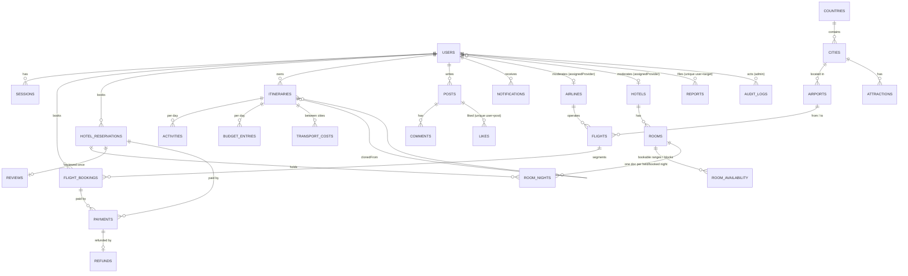

# Data model (ERD)

One MongoDB Atlas database (replica set). Collections are grouped by the module that owns them. Each owner finalizes their own schema in their Sprint 0 design task (TRVL-137 to TRVL-143). **Implemented** marks schemas already in `develop`; the rest are the agreed design.

**Embed or reference** (brief section 5): bounded, parent-owned data is embedded (cabins in a flight, passengers in a booking, itinerary days). Shared or independently changing data is referenced (users, providers, rooms, payments).

## Collections

| Collection | Owner (task) | Key fields | Indexes and constraints |
|---|---|---|---|
| `users` | Abdelrahman (TRVL-137) | email, passwordHash, role, status, assignedProvider{type, providerId}, preferredCurrency, failedLoginCount, lockedUntil | unique `email` (lowercased) |
| `sessions` | Abdelrahman (TRVL-137) | userId, refreshTokenHash, lastActivityAt, expiresAt, revokedAt | TTL on `expiresAt` |
| `airlines` | Joudy (TRVL-138), **implemented** | name, code, logoUrl, isActive, policy{cancellationTiers[{daysBefore, refundPercent}], extraBaggage{pricePerBagMinor, maxExtraBagsPerPassenger}} | unique `code` |
| `flights` | Joudy (TRVL-138), **implemented** | airlineId, flightNumber, from/to IATA, departureUtc, arrivalUtc, departureLocalDate (origin-local YYYY-MM-DD), status (SCHEDULED, CANCELLED, DEPARTED), cabins[{_id, class, totalSeats, seatsAvailable, priceMinor, freeBags, maxKgPerBag}] | unique {airlineId, flightNumber, departureLocalDate} (FLT-03); {from, to, status, departureUtc} (FLT-11 search); {status, departureUtc} (FLT-30); seats decremented with a conditional `$inc` (ADR-0002); booked + held = totalSeats - seatsAvailable |
| `flight_bookings` | Karim (TRVL-139) | userId, segments[], passengers[], totalMinor, status, holdExpiresAt, policySnapshot, policiesAcceptedAt, paymentId, refundId, reference | unique `reference` (sparse); {status, holdExpiresAt}; {userId, createdAt} |
| `hotels` | Sandra (TRVL-140) | name, cityId, countryCode, images, isActive, policy{cancellationTiers, checkInTime, checkOutTime}, averageRating | {cityId, isActive} |
| `rooms` | Sandra (TRVL-140) | hotelId, number, type, beds, maxOccupancy, priceMinor, isActive | unique {hotelId, number} |
| `room_nights` | Sandra (TRVL-140) | roomId, date (YYYY-MM-DD), reservationId, state HELD/BOOKED, holdExpiresAt | **unique {roomId, date}**: the database refuses double booking (ADR-0002) |
| `hotel_reservations` | Karim (TRVL-139) | userId, hotelId, checkIn, checkOut, rooms[{roomId, adults, childrenAges, nightlyPriceMinor}], lifecycle fields like flight_bookings | as flight_bookings |
| `reviews` | Karim / Sandra (TRVL-140) | reservationId, hotelId, userId, rating, text, isHidden | unique `reservationId` |
| `payments` | Ahmed (TRVL-161), **implemented** | bookingType, bookingId, userId, stripePaymentIntentId, amountMinor, currency, status, attempts | unique `stripePaymentIntentId`; unique {bookingType, bookingId} where SUCCEEDED |
| `refunds` | Ahmed (TRVL-161), **implemented** | paymentId, booking ref, amountMinor, refundPercent, tierApplied, reason, status, stripeRefundId | unique {bookingType, bookingId}; unique `stripeRefundId` when present |
| `stripe_events` | Ahmed (TRVL-161), **implemented** | stripeEventId, type, processedAt | unique `stripeEventId`; TTL 30 days |
| `itineraries` | Sarah (TRVL-141) | ownerId, title, countries, startDate, visibility, days[{order, cityId, notes}], clonedFrom{itineraryId, authorId}, isHidden | {ownerId, updatedAt}; text index for public search |
| `activities` | Sarah (TRVL-141) | itineraryId, dayId, name, time, costMinor, images | {itineraryId, dayId} |
| `budget_entries`, `transport_costs` | Malak (TRVL-143) | itineraryId, dayId, category, amountMinor, currency | {itineraryId} |
| `exchange_rates` | Ahmed (TRVL-133) | base, rateDate, rates{CODE: rate} | unique {base, rateDate} |
| `posts`, `comments`, `likes`, `reports` | Malak (TRVL-142) | authorId, status DRAFT/PUBLISHED, tags, isHidden, likeCount, commentCount | unique {postId, userId} on likes; unique {reporterId, targetType, targetId} on reports |
| `notifications` | Karim (TRVL-139) | userId, type, title, body, link, readAt | {userId, readAt, createdAt} |
| `audit_logs` | Ahmed (TRVL-162), **implemented** | actorId, actorRole, action, targetType, targetId, reason, metadata | {createdAt:-1}, {actorId, createdAt}, {targetType, targetId}; append-only |
| `countries`, `cities`, `airports`, `attractions`, `currencies` | Joudy (GEN-12) | dataset ids (ISO code, city_id, IATA) | unique dataset ids; seeded from the official datasets |
