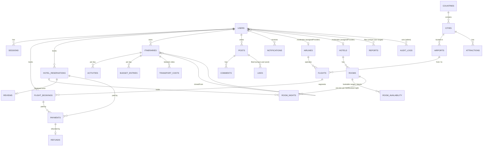

# Data model (ERD)

One MongoDB Atlas database (replica set). Collections are grouped by the module that owns them. Each owner finalizes their own schema in their Sprint 0 design task (TRVL-137 to TRVL-143). **Implemented** marks schemas already in `develop`; the rest are the agreed design.

**Embed or reference** (brief section 5): bounded, parent-owned data is embedded (cabins in a flight, passengers in a booking, itinerary days). Shared or independently changing data is referenced (users, providers, rooms, payments).

## Collections

| Collection | Owner (task) | Key fields | Indexes and constraints |
|---|---|---|---|
| `users` | Abdelrahman (TRVL-137), **implemented** | name, email, passwordHash (never selected or serialised by default), phone, preferredCurrency, termsAcceptedAt, role, status (ACTIVE, SUSPENDED, DEACTIVATED), mustChangePassword, failedLoginCount, lastLoginAttemptAt, lockedUntil, assignedProvider{type, providerId} (required for moderators, forbidden for other roles) | unique `email` (lowercased); {role}; {status}; {createdAt:-1} (ACC-14) |
| `sessions` | Abdelrahman (TRVL-137), **implemented** | userId, refreshTokenHash (SHA-256 hex), previousRefreshTokenHash and rotatedAt (refresh-token reuse detection), lastActivityAt, expiresAt, revokedAt | unique `refreshTokenHash`; {previousRefreshTokenHash}; {userId}; TTL on `expiresAt` |
| `airlines` | Joudy (TRVL-138), **implemented** | name, code, logoUrl, isActive, policy{cancellationTiers[{daysBefore, refundPercent}], extraBaggage{pricePerBagMinor, maxExtraBagsPerPassenger}} | unique `code` |
| `flights` | Joudy (TRVL-138), **implemented** | airlineId, flightNumber, from/to IATA, departureUtc, arrivalUtc, departureLocalDate (origin-local YYYY-MM-DD), status (SCHEDULED, CANCELLED, DEPARTED), cabins[{_id, class, totalSeats, seatsAvailable, priceMinor, freeBags, maxKgPerBag}] | unique {airlineId, flightNumber, departureLocalDate} (FLT-03); {from, to, status, departureUtc} (FLT-11 search); {status, departureUtc} (FLT-30); seats decremented with a conditional `$inc` (ADR-0002); booked + held = totalSeats - seatsAvailable |
| `flight_bookings` | bookings module (TRVL-139), **implemented** | userId, tripType ONE_WAY/ROUND_TRIP, segments[1..2]{flightId, cabinId, cabinClass, airlineId, flightNumber, from, to, departureUtc, arrivalUtc, seats, fareMinor}, passengers[]{type ADULT/CHILD/INFANT, firstName, lastName, dateOfBirth, documentNumber, extraBags}, totalMinor, currency, status, holdExpiresAt, startsAt (first departure), endsAt (last arrival), policySnapshot, policiesAcceptedAt, paymentId, refundId, reference (FL-/HT- plus 8 Crockford base32), confirmedAt, cancelledAt, cancelledBy USER/PROVIDER | unique `reference` only when it is a string (partial index; `sparse` would collide on null); {holdExpiresAt} partial on PENDING_PAYMENT (expiry job); {status, endsAt}; {userId, status, endsAt} (ACC-12); {userId, createdAt}; {paymentId} when set; {segments.flightId, status}. Validated: a round trip has 2 segments, endsAt > startsAt |
| `hotels` | Sandra (TRVL-140) | name, cityId, countryCode, images, isActive, checkInTime, checkOutTime (HTL-09, local HH:mm), cancellationTiers[{daysBefore, refundPercent 0-100 up to 2 decimals}] (HTL-10, sorted, unique thresholds), averageRating | {cityId, isActive} |
| `rooms` | Sandra (TRVL-140) | hotelId, number, type, beds, maxOccupancy, priceMinor, isActive | unique {hotelId, number} |
| `room_nights` | Sandra (TRVL-140) | roomId, date (YYYY-MM-DD), reservationId, state HELD/BOOKED, holdExpiresAt | **unique {roomId, date}**: the database refuses double booking (ADR-0002) |
| `hotel_reservations` | bookings module (TRVL-139), **implemented** | userId, hotelId, checkIn, checkOut (hotel-local dates), nights, timeZone, rooms[{roomId, roomNumber, adults, childrenAges (0-17), nightlyPriceMinor, subtotalMinor}], totalMinor, currency, status, holdExpiresAt, startsAt (start of the check-in day) / endsAt (end of the check-out day) in the hotel's zone, policySnapshot, policiesAcceptedAt, paymentId, refundId, reference | as flight_bookings, plus {hotelId, status}. Validated: checkOut > checkIn |
| `reviews` | Karim / Sandra (TRVL-140) | reservationId, hotelId, userId, rating, text, isHidden | unique `reservationId` |
| `payments` | Ahmed (TRVL-161), **implemented** | bookingType, bookingId, userId, stripePaymentIntentId, amountMinor, currency, status, attempts | unique `stripePaymentIntentId`; unique {bookingType, bookingId} where SUCCEEDED |
| `refunds` | Ahmed (TRVL-161), **implemented** | paymentId, booking ref, amountMinor, refundPercent, tierApplied, reason, status, stripeRefundId | unique {bookingType, bookingId}; unique `stripeRefundId` when present |
| `stripe_events` | Ahmed (TRVL-161), **implemented** | stripeEventId, type, processedAt | unique `stripeEventId`; TTL 30 days |
| `itineraries` | Sarah (TRVL-141), **implemented** | ownerId, title (max 100), countries (seeded ISO codes), startDate (YYYY-MM-DD), visibility PUBLIC/PRIVATE (private by default), days[{_id, order, cityId, notes}] (1..60), clonedFrom{itineraryId, authorId, authorName}, isHidden | {ownerId, updatedAt}; text index for public search |
| `activities` | Sarah (TRVL-141), **implemented** | itineraryId, dayId (embedded day's `_id`), name, description, optional time (HH:mm), optional costMinor/currency, images (URLs) | {itineraryId, dayId}; max 5 images |
| `budget_entries`, `transport_costs` | Malak (TRVL-143), schemas **implemented** (ITN-16 PR) | budget_entries: itineraryId, dayId (days[]._id), category FOOD/ACCOMMODATION/IN_CITY_TRANSPORT/ACTIVITIES, amountMinor (whole, >= 0), currency (seeded code), note. transport_costs: itineraryId, dayId, mode FLIGHT/TRAIN/BUS/CAR/FERRY/OTHER, fromCityId, toCityId (reference city ids, different), amountMinor, currency. Amounts are stored in the currency the user chose | {itineraryId, dayId} on both |
| `exchange_rates` | Ahmed (TRVL-133), **implemented** | base (PLATFORM_CURRENCY), rateDate (YYYY-MM-DD, UTC day from the API), rates{CODE: rate per 1 base, finite > 0; base itself implicit 1}, fetchedAt. One document per day; old days kept as the fallback cache (ITN-18) | unique {base, rateDate} |
| `posts`, `comments`, `likes` | Malak (TRVL-142); posts, comments and likes schemas **implemented** (#75) | posts: authorId, title (<=150), body, tags (<=5, <=30 chars, lowercased, no repeats), images (<=5, uploaded under GEN-08), status DRAFT/PUBLISHED, publishedAt, isHidden, likeCount, commentCount, interactionScore (likes + comments, BLG-09 order). comments: postId, authorId, body (1-500), isHidden. likes: postId, userId | unique {postId, userId} on likes; posts {status, isHidden, publishedAt:-1}, {tags, status, isHidden, publishedAt:-1}, {status, isHidden, interactionScore:-1, publishedAt:-1}, {authorId, createdAt:-1}; comments {postId, createdAt} |
| `reports` | Ahmed (GEN-09), **implemented** (#106) | reporterId, targetType POST/COMMENT/REVIEW/ITINERARY, targetId, reason (1-500 characters after trimming), status OPEN/DISMISSED/HIDDEN/DELETED (starts OPEN), resolvedBy, resolvedAt, resolutionNote (set by GEN-10) | **unique {reporterId, targetType, targetId}**: one report per user and item (409 `REPORT_ALREADY_FILED`, also when two arrive at once); {status, createdAt:-1} (GEN-10 queue); {targetType, targetId} (resolving an item resolves all its reports) |
| `notifications` | Ahmed (TRVL-96), **implemented** | userId, type, title, body, link (frontend route starting with a single /), readAt (null until read) | {userId, readAt, createdAt} for unread count and read-all; {userId, createdAt:-1, _id:-1} for the newest-first list |
| `audit_logs` | Ahmed (TRVL-162), **implemented** | actorId, actorRole, action, targetType, targetId, reason, metadata | {createdAt:-1}, {actorId, createdAt}, {targetType, targetId}; append-only |
| `countries`, `cities`, `airports`, `attractions`, `currencies` | Joudy (GEN-12) | dataset ids (ISO code, city_id, IATA) | unique dataset ids; seeded from the official datasets |

### Itinerary day rules (TRVL-141)

Days are embedded in their itinerary and numbered sequentially from 1, with no gaps or duplicates and a maximum of 60 days. A day's calendar date is derived with `addDays(startDate, order - 1)`; it is not stored separately. Consecutive days with the same seeded `cityId` form one city group in day order. A later return to a city starts a separate group. Activity `dayId` stores the embedded day's MongoDB `_id`.
